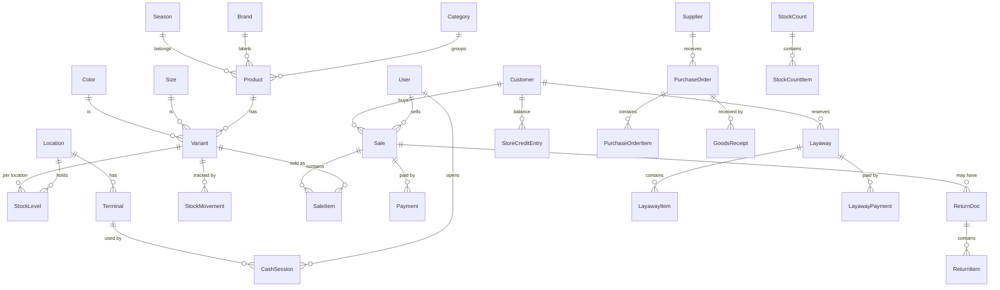

# Modelo de datos

> Especificación para implementar en `prisma/schema.prisma`. Los nombres están en inglés (así van en código); la descripción, en español.
> Convenciones: `id` = `String @id @default(cuid())`; todos los modelos llevan `createdAt` y `updatedAt`; los que se archivan llevan `archivedAt DateTime?`. **Todo dinero es `Int` en centavos** (sufijo `Cents`). Las cantidades de prendas son `Int`.

## 1. Diagrama (alto nivel)

## 2. Acceso y configuración

### User
| Campo | Tipo | Notas |
|---|---|---|
| name | String | |
| username | String @unique | para login |
| email | String? @unique | |
| passwordHash | String | argon2/bcrypt |
| pinHash | String? | cambio rápido de cajero |
| role | enum `OWNER, MANAGER, CASHIER, WAREHOUSE` | mapea a conjunto de capacidades |
| isActive | Boolean | desactivar en vez de borrar |
| failedLogins | Int, lockedUntil DateTime? | bloqueo por intentos |
| lastLoginAt | DateTime? | |

### Location (sucursal/bodega)
`name`, `code @unique`, `address?`, `isDefault Boolean`, `type enum (STORE, WAREHOUSE)`. Hoy existe una sola; todo el stock cuelga de aquí.

### Terminal (caja física)
`name`, `locationId`, `isActive`. Define dónde se abren las sesiones de caja.

### Setting
Clave/valor tipado por ámbito (`key @unique`, `valueJson`). Ejemplos: `tax.rate`, `tax.pricesIncludeTax`, `sales.allowNegativeStock`, `discount.maxPercent.CASHIER`, `returns.maxDays`, `layaway.expiryDays`, `ticket.footer`. Con helper tipado en `src/lib/settings.ts`.

### BusinessProfile
`legalName`, `tradeName`, `taxId (RTN)`, `address`, `phone`, `logoUrl?`.

### FiscalRange (rango CAI)
| Campo | Notas |
|---|---|
| documentType | `INVOICE`, `CREDIT_NOTE`… |
| terminalId | `Terminal?`; `null` = rango general (sin punto de emisión propio) |
| cai | String |
| prefix | p. ej. `000-001-01-` |
| rangeStart / rangeEnd | Int |
| nextNumber | Int (**se incrementa solo dentro de la transacción de venta**) |
| expiresAt | DateTime (fecha límite de emisión) |
| isActive | Boolean |

Invariantes: `nextNumber` ∈ [`rangeStart`, `rangeEnd`+1]; no se emite si `now > expiresAt` o `nextNumber > rangeEnd`. Solo un rango activo por tipo y terminal/punto de emisión (índice parcial único en la migración `constraints`, ver §11).

### Session
Sesiones en BD, revocables (forma compatible con Auth.js). `sessionToken @unique`, `userId` (`onDelete: Cascade`), `expires`, `ip?`, `userAgent?`, `createdAt`, `updatedAt`. Índices por `userId` y `expires`.

### DocumentCounter
Numeración correlativa interna sin saltos (ticket, devolución, apartado…). `key` es la clave primaria (p. ej. `SALE`, `RETURN`, `LAYAWAY`, `PURCHASE_ORDER`), `nextValue Int` (por defecto 1) y `updatedAt`. Se incrementa con bloqueo de fila dentro de la transacción del documento.

### AuditLog
`userId?`, `action String` (p. ej. `SALE_VOIDED`), `entityType`, `entityId`, `before Json?`, `after Json?`, `reason String?`, `ip?`, `createdAt`. **Solo inserción**; nunca update/delete. Índices por `(entityType, entityId)`, `(userId, createdAt)` y `(action, createdAt)`.

## 3. Catálogo

### Category
`name`, `parentId?` (auto-referencia), `slug @unique`, `sortOrder`, `allowsReturns Boolean @default(true)`.

### Brand · Season
`name @unique`; Season además `startsAt?`, `endsAt?` (p. ej. "Primavera-Verano 2026").

### Size · Color
- **Size:** `name @unique` (S, M, 38…), `sortOrder`, `group?` (ropa, calzado, números).
- **Color:** `name @unique`, `hex?`, `sortOrder`.

### Supplier
`name`, `taxId?`, `contactName?`, `phone?`, `email?`, `address?`, `paymentTerms?`, `notes?`, `archivedAt?`.

### Product
| Campo | Notas |
|---|---|
| code | `String @unique`, base del SKU de sus variantes |
| name | |
| description | String? |
| categoryId | |
| brandId? | |
| seasonId? | |
| defaultSupplierId? | |
| basePriceCents | precio público (con ISV incluido si así se configura) |
| baseCostCents | costo de referencia |
| taxCategory | enum `STANDARD, EXEMPT` (para ISV) |
| imageUrl? | |
| archivedAt? | |

### Variant (la unidad que se vende y se cuenta)
| Campo | Notas |
|---|---|
| productId | |
| sizeId?, colorId? | al menos uno o variante "única" |
| sku | `@unique`, generado: `{código producto}-{talla}-{color}` (sin tildes, en mayúsculas; si choca, sufijo `-2`, `-3`…) |
| barcode | `@unique`, EAN-13 interno generado: prefijo `200` + serie de 9 dígitos (`barcode_serial_seq`) + dígito de control |
| priceCents? | si es null hereda `Product.basePriceCents` |
| costCents? | si es null hereda `Product.baseCostCents` |
| avgCostCents | costo promedio ponderado, actualizado por compras |
| reorderPoint | Int? stock mínimo |
| archivedAt? | |

Restricción: `(productId, sizeId, colorId)` es un índice único `NULLS NOT DISTINCT` creado en la migración `constraints` (Prisma no puede expresarlo), de modo que una variante sin talla o sin color tampoco se duplica.

### PriceHistory
`variantId` o `productId`, `oldPriceCents`, `newPriceCents`, `oldCostCents`, `newCostCents`, `changedById`, `changedAt`, `reason?`.

## 4. Inventario

### StockLevel (acumulado — **no se edita directamente**)
`variantId`, `locationId`, `onHand Int`, `reserved Int` (apartados). `available = onHand − reserved`.
`@@unique([variantId, locationId])`. No hay CHECK de `onHand >= 0` en la BD: depende de `sales.allowNegativeStock` y se valida en `inventory.recordMovement`. Sí hay CHECK `reserved >= 0`.

### StockMovement (kardex — **fuente de verdad, solo inserción**)
| Campo | Notas |
|---|---|
| variantId, locationId | |
| type | enum `PURCHASE_IN, SALE_OUT, RETURN_IN, RETURN_SCRAP, ADJUSTMENT_IN, ADJUSTMENT_OUT, COUNT_ADJUSTMENT, TRANSFER_OUT, TRANSFER_IN, LAYAWAY_RESERVE, LAYAWAY_RELEASE, INITIAL` |
| quantity | Int con signo (+ entra, − sale) |
| unitCostCents | costo al momento |
| refType, refId | documento origen (`Sale`, `GoodsReceipt`, `StockCount`…) |
| reason | String? (obligatorio en ajustes) |
| userId | |
| createdAt | |

Invariante: para cada `(variantId, locationId)`, `Σ quantity (excluyendo reservas) = StockLevel.onHand`. Debe existir un test y un script de **reconciliación** que lo verifique.

### StockCount / StockCountItem
- **StockCount:** `locationId`, `status enum (OPEN, IN_REVIEW, APPLIED, CANCELLED)`, `scope` (todo / categoría / zona), `scopeRef?` (id de categoría o nombre de zona, según `scope`), `startedById`, `approvedById?`, `appliedAt?`.
- **StockCountItem:** `stockCountId`, `variantId`, `expectedQty` (congelado al abrir), `countedQty`, `difference` (derivado), `note?`. Único en `(stockCountId, variantId)`.
Al **aplicar** se genera un `StockMovement` `COUNT_ADJUSTMENT` por cada diferencia.

## 5. Compras

### PurchaseOrder
`supplierId`, `locationId`, `number @unique`, `status enum (DRAFT, ORDERED, PARTIALLY_RECEIVED, RECEIVED, CANCELLED)`, `expectedAt?`, `notes?`, `createdById`.
### PurchaseOrderItem
`purchaseOrderId`, `variantId`, `orderedQty`, `receivedQty`, `unitCostCents`. Único en `(purchaseOrderId, variantId)`.
### GoodsReceipt / GoodsReceiptItem
Recepción (puede ser sin orden). `number @unique`, `supplierId`, `locationId`, `purchaseOrderId?`, `supplierInvoiceRef?`, `receivedById`, `receivedAt`; ítems con `variantId`, `quantity`, `unitCostCents`.
Al confirmar: crea `StockMovement PURCHASE_IN`, actualiza `StockLevel`, recalcula `avgCostCents`.

## 6. Ventas

### Customer
`name`, `phone? @unique(nullable)`, `email?`, `taxId?`, `notes?`, `preferredSizes?` (texto libre), `storeCreditCents` (**derivado/cacheado** del libro `StoreCreditEntry`), `archivedAt?`.

### CashSession (turno de caja)
`terminalId`, `userId`, `openedAt`, `openingFloatCents`, `closedAt?`, `expectedCashCents?`, `countedCashCents?`, `differenceCents?`, `status enum (OPEN, CLOSED_PENDING_APPROVAL, CLOSED)`, `approvedById?`, `notes?`.
Restricción: máximo una sesión `OPEN` por usuario y por terminal (índice parcial).
Ciclo: `OPEN` → (el cajero cierra con arqueo: guarda `expectedCashCents`, `countedCashCents`, `differenceCents`; si la diferencia no es 0, `notes` es obligatorio) `CLOSED_PENDING_APPROVAL` → (gerente o propietario aprueba: `approvedById`) `CLOSED`. El desglose por billetes y monedas, si se usó, queda en el `after` del `AuditLog` `CASH_SESSION_CLOSED`. Mientras está `OPEN`, lo esperado se calcula al momento; al cerrar se congela.

### CashMovement
Entradas/salidas manuales: `cashSessionId`, `type (IN, OUT)`, `amountCents` (> 0), `reason` (obligatorio, ≥ 3 caracteres), `userId`. Una salida no puede superar el efectivo esperado en ese momento (la sesión se bloquea con `FOR UPDATE` mientras se decide).

### Sale
| Campo | Notas |
|---|---|
| number | correlativo interno `@unique` |
| clientRequestId | `@unique` — **idempotencia** |
| status | `COMPLETED, VOIDED` (las ventas en espera viven en el cliente o en `ParkedSale`) |
| locationId, terminalId, cashSessionId | |
| sellerId | usuario que vendió |
| customerId? | |
| subtotalCents | suma de líneas antes de descuento global |
| discountCents | descuento global |
| taxCents | ISV incluido en el total |
| totalCents | lo que paga el cliente |
| paidCents / changeCents | |
| fiscalDocType?, fiscalNumber?, fiscalRangeId? | si se emitió factura; `@@unique([fiscalRangeId, fiscalNumber])` |
| customerTaxId?, customerNameOnInvoice? | datos a nombre en la factura |
| voidedAt?, voidedById?, voidReason? | |
| createdAt | |

Invariante: `totalCents = subtotal − discount` (con ISV incluido: `taxCents` es informativo); `Σ Payment.amountCents − changeCents = totalCents`.

### SaleItem (snapshot)
`saleId`, `variantId`, `quantity`, `unitPriceCents`, `unitCostCents`, `lineDiscountCents`, `taxRate` (basis points, p. ej. 1500), `taxCents`, `lineTotalCents`, y **copias de texto** `productName`, `sizeName`, `colorName`, `sku` (para que el recibo histórico no cambie si se renombra el producto).

### Payment
`saleId`, `method enum (CASH, CARD, TRANSFER, STORE_CREDIT, OTHER)`, `amountCents`, `reference?` (últimos 4 / # autorización / # transferencia), `cashSessionId`.
Datos de tarjeta **nunca**: solo monto y referencia.

### ParkedSale (venta en espera, opcional en servidor)
`userId`, `terminalId`, `payloadJson`, `createdAt`. Alternativa: solo en el cliente (Zustand + `localStorage`); decisión en `ARCHITECTURE.md`.

## 7. Devoluciones, apartados, crédito

### ReturnDoc
`number @unique`, `saleId` (venta original), `type enum (RETURN, EXCHANGE)`, `exchangeSaleId?` (venta nueva si es cambio), `reason`, `refundMethod enum (ORIGINAL, CASH, STORE_CREDIT, NONE)`, `refundCents`, `cashSessionId`, `processedById`, `authorizedById?`, `fiscalNumber?`, `fiscalRangeId?` (nota de crédito, si aplica; `@@unique([fiscalRangeId, fiscalNumber])`), `createdAt`.
### ReturnItem
`returnId`, `saleItemId`, `quantity`, `condition enum (RESELLABLE, DAMAGED)`, `refundCents`, `reason`.
Invariante: Σ `ReturnItem.quantity` por `saleItemId` ≤ `SaleItem.quantity`.

### Layaway (apartado)
`number`, `customerId`, `status enum (ACTIVE, COMPLETED, CANCELLED, EXPIRED)`, `totalCents`, `paidCents`, `expiresAt`, `saleId?` (al saldar), `createdById`.
### LayawayItem · LayawayPayment
Ítems con snapshot de precio; pagos con `method`, `amountCents`, `cashSessionId`, `createdAt`.
Al crear: `StockLevel.reserved += qty` (movimiento `LAYAWAY_RESERVE`). Al cancelar/expirar: `LAYAWAY_RELEASE`.

### StoreCreditEntry (libro del crédito de tienda — solo inserción)
`customerId`, `amountCents` (+ abona, − consume), `reason enum (RETURN, LAYAWAY_CANCEL, MANUAL, USED_IN_SALE)`, `refType`, `refId`, `userId`, `createdAt`.
`Customer.storeCreditCents` = Σ del libro (se mantiene en la misma transacción).

## 8. Índices recomendados

- `Variant(barcode)`, `Variant(sku)` únicos; índice trigram (`pg_trgm`) en `Product.name` + `Variant.sku` para búsqueda tolerante.
- `StockMovement(variantId, locationId, createdAt)`; `StockMovement(refType, refId)`.
- `Sale(createdAt)`, `Sale(sellerId, createdAt)`, `Sale(cashSessionId)`, `Sale(customerId)`.
- `SaleItem(variantId)`, `Payment(saleId)`, `Payment(cashSessionId, method)`.
- `AuditLog(entityType, entityId)`, `AuditLog(userId, createdAt)`.

## 9. Invariantes globales (deben tener test)

1. `Σ StockMovement.quantity = StockLevel.onHand` para cada variante y ubicación.
2. `Σ Payment − change = Sale.total` para toda venta completada.
3. `Σ ReturnItem.quantity ≤ SaleItem.quantity` por línea.
4. Los correlativos fiscales no tienen saltos ni repeticiones y están dentro del rango vigente.
5. `Customer.storeCreditCents = Σ StoreCreditEntry.amountCents`.
6. `CashSession.expectedCash = opening + Σ Payment CASH − Σ Sale.changeCents + Σ CashMovement IN − Σ CashMovement OUT − reembolsos en efectivo`, solo con ventas `COMPLETED` (las anuladas no cuentan). `Payment.amountCents` en efectivo es lo que entregó el cliente (vuelto incluido); el vuelto se resta aparte. Función pura: `src/modules/cash/expected.ts`.
7. Una venta `VOIDED` revierte exactamente sus movimientos de stock y de pago.

## 10. Datos de ejemplo (seed)

> La **Fase 0** solo carga la semilla mínima (ubicación, terminal, cuatro usuarios, tallas, colores, categorías, perfil del negocio, ajustes por defecto y contadores de documentos). La semilla de demostración grande de abajo llega en fases posteriores.

Una `Location` + `Terminal`; 4 usuarios (uno por rol, con contraseñas de demo documentadas solo para desarrollo); tallas XS–XXL y 34–42; ~12 colores; ~8 categorías; ~30 productos con ~150 variantes y stock; 10 clientes; 40 ventas distribuidas en 30 días; un rango CAI de demo; un apartado activo.

## 11. Restricciones de la migración `constraints`

Lo que Prisma no puede expresar vive en la segunda migración (`constraints`):

- **Extensiones:** `pg_trgm` y `unaccent`.
- **Unicidad con NULL:** índice único `NULLS NOT DISTINCT` sobre `Variant(productId, sizeId, colorId)`.
- **Índices parciales únicos:** una caja abierta por usuario y por terminal (`CashSession`, `status = 'OPEN'`) y un rango fiscal activo por tipo y terminal (`FiscalRange`).
- **CHECK de montos y cantidades:** importes no negativos, cantidades positivas, `reserved >= 0`, `nextNumber` dentro del rango fiscal, descuento no mayor que el subtotal. No hay CHECK de `onHand >= 0` (ver §4).
- **Tablas de solo inserción:** triggers `prevent_row_mutation` que rechazan `UPDATE` y `DELETE` en `AuditLog`, `StockMovement` y `StoreCreditEntry`.
- **Búsqueda tolerante a errores:** índices `gin` trigram sobre `Product.name` y `Variant.sku`. La consulta del listado compara con `unaccent(lower(...))` (no usa esos índices; basta a escala de boutique) y combina coincidencia exacta de código o barras, "contiene" y similitud de trigramas.
- **Secuencias de códigos:** `product_code_seq` (códigos `P00001`…) y `barcode_serial_seq` (serie de los EAN-13 internos). Pueden dejar huecos; solo garantizan unicidad (la numeración sin saltos es la de facturas).
