# Manual del cajero (1 página)

Todo lo que necesitas para vender. Si algo no sale como aquí, pídele ayuda al gerente: no pasa nada por preguntar.

## 1. Entrar y abrir tu caja

1. Entra con tu **usuario y contraseña**.
2. Ve a **Vender**. Si no hay caja abierta, ahí mismo te pide abrirla: cuenta el efectivo con el que empiezas (el *fondo inicial*), escríbelo y pulsa **Abrir caja**. Si empiezas sin efectivo, escribe 0. **Si ayer quedó efectivo en el cajón, ves el *saldo anterior* y la caja abre con él: no se puede cambiar.** Si al contar el cajón hay otra cantidad, abre igual y registra la diferencia con **Ingresar efectivo** o **Retirar efectivo**, con su motivo: así queda todo anotado.

| Entrar | Abrir caja | Con el saldo anterior |
| :---: | :---: | :---: |
| 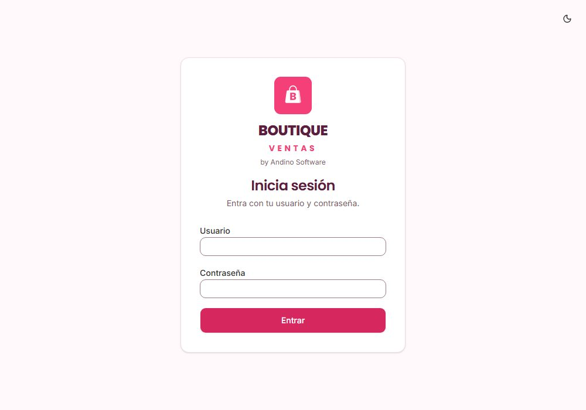 | 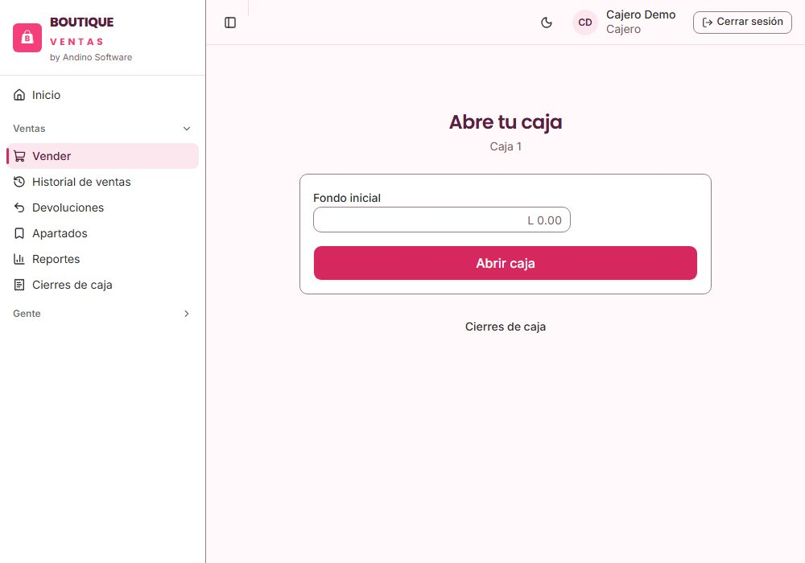 | 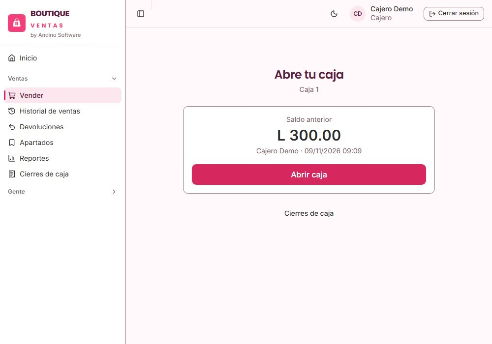 |

## 2. Vender (lo de todos los días)

1. Ve a **Vender**. Escanea la etiqueta de la prenda con el lector, o escribe en la búsqueda un pedazo del nombre, el color o el código (**F2** te lleva a la búsqueda).
2. Si la prenda tiene varias tallas o colores, **elige la talla y el color**. Las agotadas se ven apagadas.
3. La prenda aparece en el **ticket** de la derecha. Cambia la cantidad con **+ y −**, o quita la línea con la **X**.
4. Cuando el ticket esté completo, pulsa **Cobrar** (**F12**).
5. Elige cómo paga el cliente (efectivo, tarjeta, transferencia u otro), revisa el monto y pulsa **Cobrar**. Si paga en efectivo, el sistema te dice **el cambio que debes entregar**.
6. Sale **¡Venta registrada!** con el número del ticket. Pulsa **Imprimir ticket** si el cliente lo quiere y luego **Nueva venta**.

| Buscar | Talla y color | Ticket |
| :---: | :---: | :---: |
| 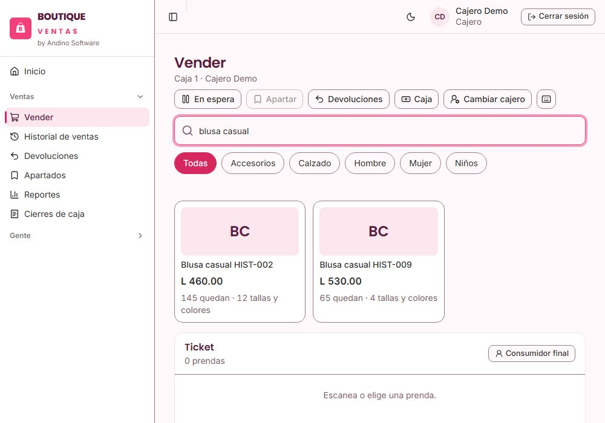 | 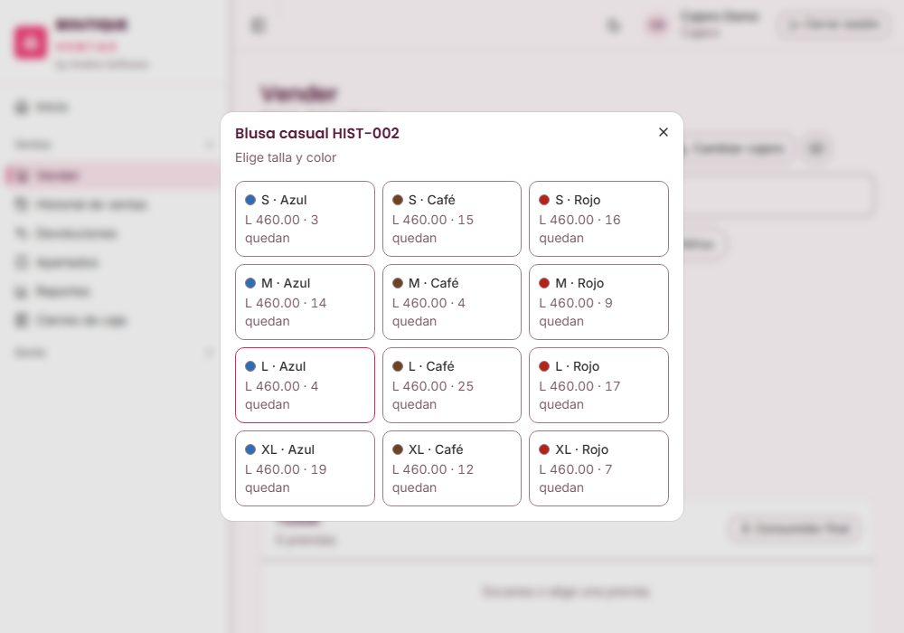 | 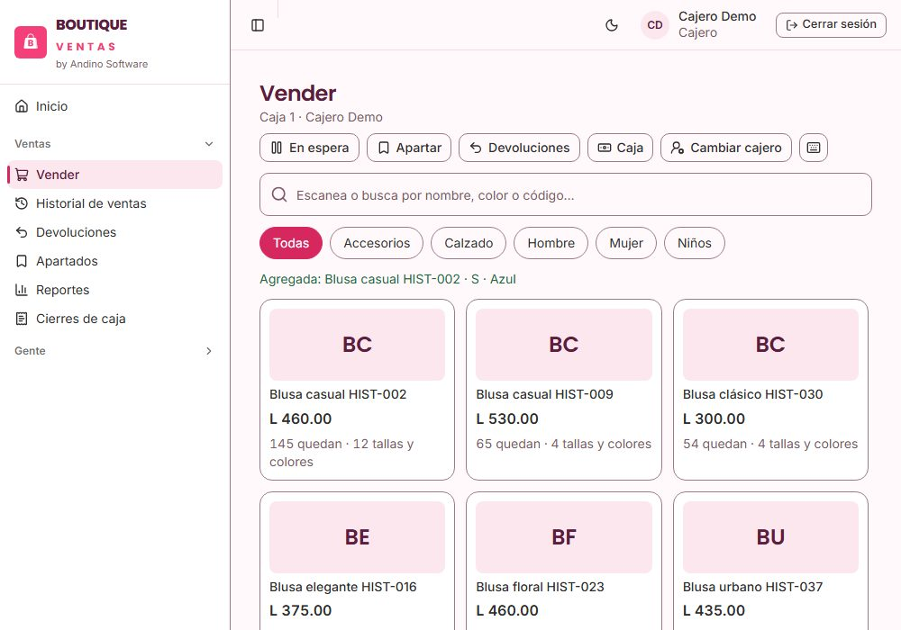 |

| Cobrar | Venta registrada |
| :---: | :---: |
| 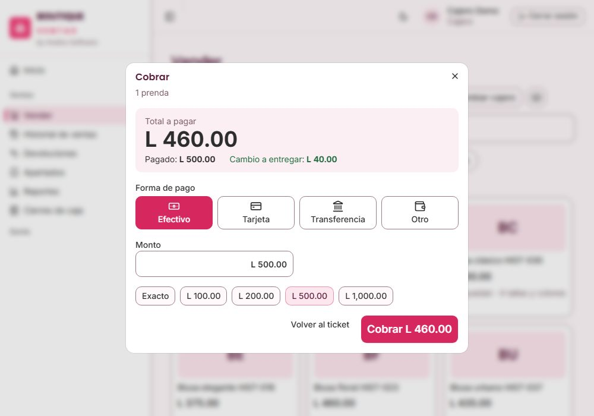 | 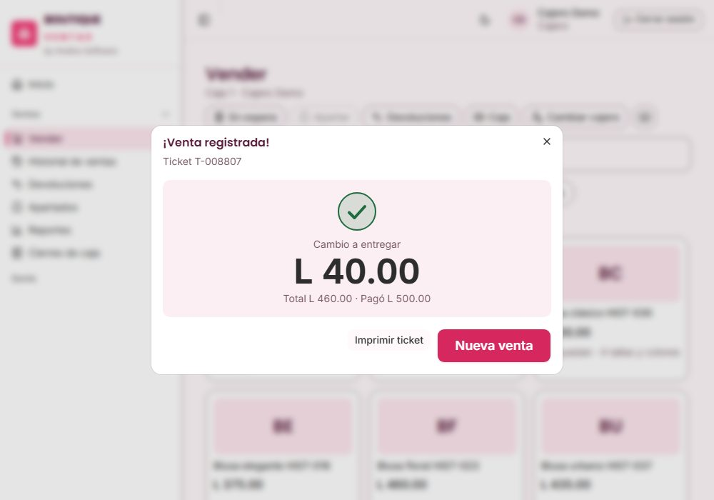 |

**El recibo** que sale al pulsar *Imprimir ticket* lleva el logo y los datos del negocio, el número, la fecha y la hora, quién te atendió, las prendas con su precio, el total y cómo pagó el cliente (recibido y cambio).

| El recibo |
| :---: |
| 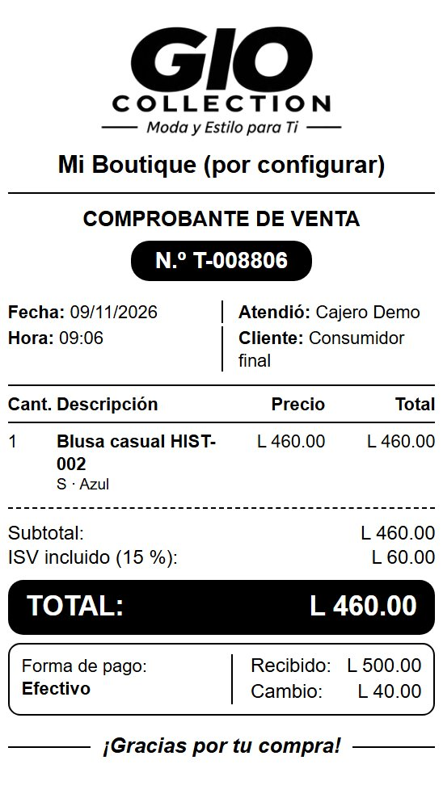 |

**Pago mixto** (por ejemplo, una parte en efectivo y otra con tarjeta): en la ventana de cobro escribe el monto de la primera forma de pago, pulsa **Agregar otro pago** y completa lo que **Falta** con la otra. **Tarjeta y transferencia** piden una *referencia* (los últimos 4 dígitos o el número de autorización; **nunca** el número completo de la tarjeta). **Factura:** si el cliente la pide, marca *Emitir factura con CAI* y escribe su RTN y nombre; si no, sale un ticket normal.

## 3. Cosas que pasan seguido

- **El cliente se arrepiente antes de pagar:** pulsa **Cancelar venta** (también está en el botón **Caja**). Te pide el **motivo** y queda anotado; no se cancela sin él. Para quitar solo una prenda, usa la **X** de su línea.
- **Un cliente espera mientras buscas algo:** pulsa **En espera** (**F6**) para guardar el ticket y atender a otro; lo recuperas en la misma ventana.
- **Descuento:** **Descuento** (**F4**). Puedes dar **hasta el 10 %** sin pedir permiso. Más que eso necesita a un gerente: él escribe su usuario y su PIN y lo autoriza.
- **El cliente quiere cambiar o devolver:** pulsa **Devoluciones** (**F8**) y busca la venta. Tiene **8 días** para hacerlo. Devolver en efectivo lo autoriza un gerente; lo normal es cambiar por otra prenda o dejar el valor como **crédito de tienda**.
- **El cliente quiere apartar:** arma el ticket y pulsa **Apartar** (**F7**). Pide el nombre del cliente y un abono mínimo.
- **Cliente frecuente:** **Cliente** (**F3**), búscalo por nombre o teléfono. Si no está, créalo ahí mismo.
- **Me equivoqué en una venta ya cobrada:** no se borra. Avísale al gerente: la corrige con una anulación (mientras tu turno siga abierto) o con una devolución.
- **Otro cajero va a tomar el mostrador:** **Cambiar cajero** (usuario y PIN); el ticket armado no se pierde.

| Cancelar venta: pide el motivo |
| :---: |
| 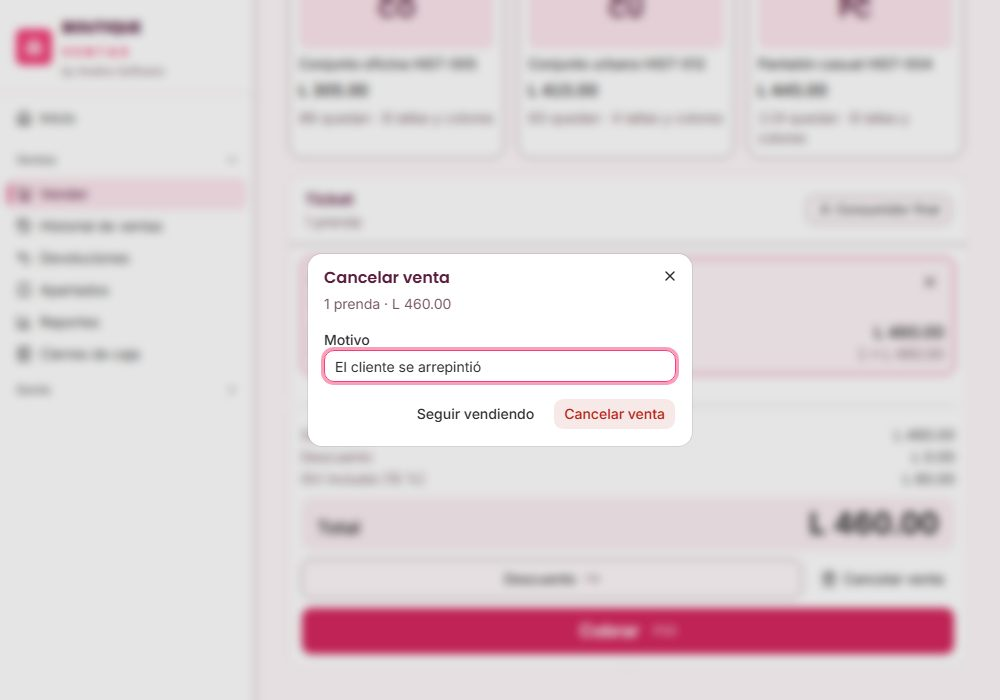 |

## 4. Cerrar tu caja al terminar

1. En **Vender**, pulsa el botón **Caja** de arriba. Se abre un panel con los botones de tu caja; arriba siempre ves el efectivo que *debe haber* según las ventas.
2. Pulsa **Realizar corte**. Cuenta los **billetes y monedas** del cajón: escribe cuántos hay de cada uno y el total sale solo. Luego pulsa **Ver diferencia**.
3. El sistema te muestra la diferencia con lo esperado. Si cuadra, sigue. Si no, vuelve a contar; si sigue sin cuadrar, explícalo en el comentario **y avisa al gerente**: él revisa y aprueba.
4. **¿Cuánto retiras?** Escribe lo que sacas del cajón para llevarlo (o para la caja de finanzas); lo que no retires **se queda en el cajón y mañana la caja abre con ese saldo**. Abajo ves cuánto queda. «Retirar todo» y «No retirar nada» te ahorran escribir.
5. Confirma el cierre y entrega el efectivo que retiraste y el resumen al gerente.

| Tu turno (botón **Caja**) | Cerrar caja con el retiro |
| :---: | :---: |
| 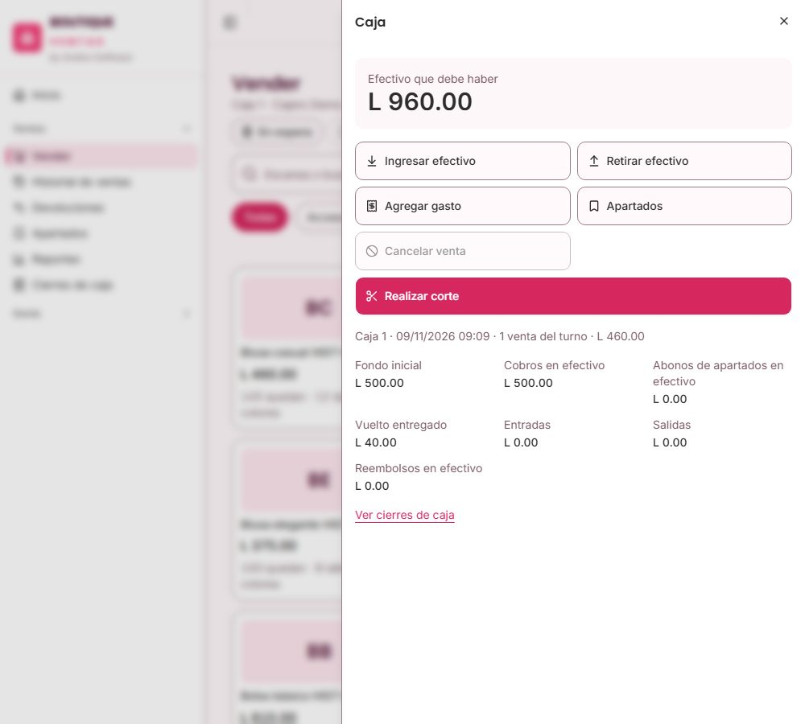 | 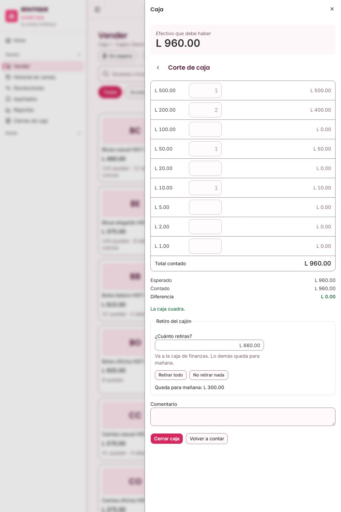 |

**Entradas y salidas de efectivo:** si pones o sacas dinero del cajón y no es una venta, regístralo en el botón **Caja** de Vender, **siempre con el motivo**; si no, el corte no va a cuadrar:

- **Ingresar efectivo:** más cambio, o el dinero que falta al contar al abrir.
- **Retirar efectivo:** dinero que sale del cajón y no es un gasto (una entrega al dueño, lo que sobra al abrir).
- **Agregar gasto:** un pago del negocio (flete, bolsas…); además del motivo se elige su categoría.

Nada de esto se edita ni se borra: si te equivocas, haz el movimiento contrario con su motivo.

## 5. Atajos útiles

**F1** muestra todos los atajos dentro del sistema. Los más usados: **F2** buscar · **F12** cobrar · **F6** en espera · **Esc** cerrar la ventana · **Supr** quitar la línea seleccionada.
